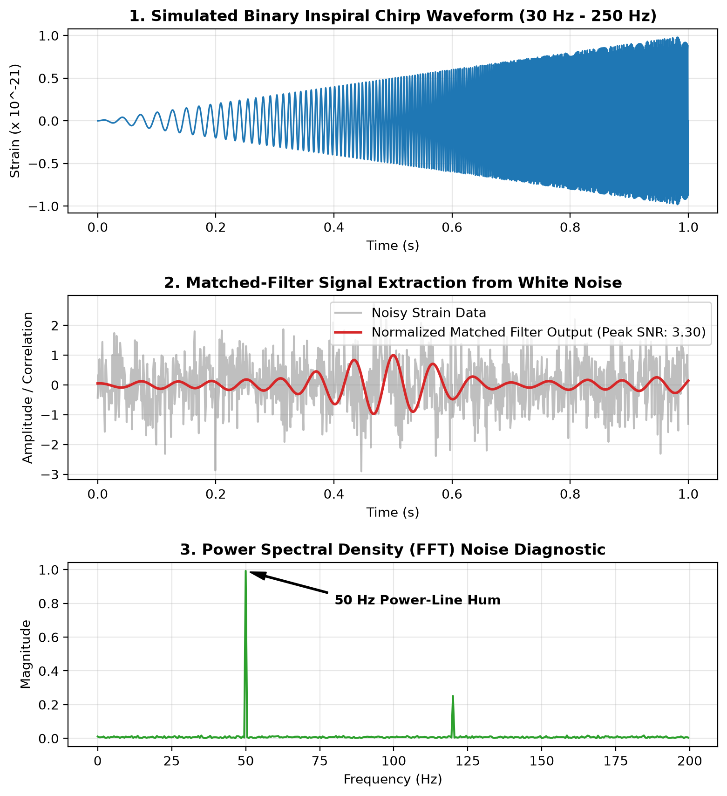

# Gravitational-Wave Signal Processing (Data & Noise)

A collection of Python scripts exploring time-series strain data, signal extraction, and noise analysis using open datasets from the LIGO Open Science Center (GWOSC).

## Overview
Gravitational-wave detectors capture faint cosmic signals buried inside heavy environmental and instrumental noise. This project implements basic signal-processing techniques to fetch real event metadata, model binary merger waveforms, and isolate signals from noisy time-series data.

## Files
* `ligo_analysis.py` – Connects to the GWOSC public API to fetch event metadata and strain data URLs for GW150914.
* `simulate_chirp.py` – Generates a synthetic time-series waveform modeling the frequency sweep ("chirp") of an inspiraling binary black hole merger.
* `matched_filter_detector.py` – Uses cross-correlation (matched filtering) to locate a known signal pattern hidden inside simulated white noise.
* `fft_noise_spectral_analysis.py` – Applies a Fast Fourier Transform (FFT) to convert time-domain signals into the frequency domain to identify specific noise peaks (such as 50 Hz power-line interference).

## Requirements & Usage
The scripts rely on standard Python libraries and `numpy`.

```bash
pip install numpy
python ligo_analysis.py
```

## Execution Output
Full terminal execution logs from all four signal-processing scripts are saved in [`results.txt`](./results.txt).

## Visual Diagnostics

